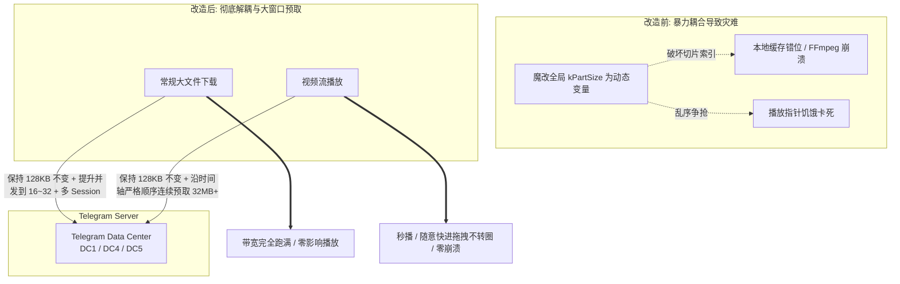

# 64Gram 下载加速与视频流媒体缓存增强方案技术文档

本文档深入剖析 **64Gram (TDesktop-x64)** 的网络传输与多媒体流播放架构，复盘历史上原作者在实现“下载加速”时遇到的底层缺陷与翻车原因，并给出**将常规文件下载与流媒体播放彻底解耦、以大窗口顺序预取消灭转圈卡顿**的全新无 Bug 改造方案。

---

## 1. 历史复盘：原版 64Gram 为什么放弃了“下载加速”？

### 1.1 历史提交证据
64Gram 曾在早期版本内置过“Download speed boost”选项，但在 **2025 年 1 月 4 日**，作者 `c0re100` 提交了 Commit **`4b52e9a41caf`**，彻底移除了该功能：
```text
commit 4b52e9a41caf61e6f5cf12f7e8616261844cbd70
Author: c0re100 <corehusky@gmail.com>
Date:   Sat Jan 4 02:05:18 2025 +0800
    Remove "Download speed boost"
```
原作者在社区反馈中指出该功能是“Bug 本身 (Download speed boost = bug itself)”，导致了大量视频卡死和崩溃。

### 1.2 原作者当年翻车的两大核心技术死因
通过对比该 Commit 涉及的 17 个文件的修改代码，可以精确定位原作者的错误所在：

1. **致命错误一：暴力魔改底层切片常量，破坏了虚拟文件系统**
   * Telegram Desktop 的流媒体播放器并不是普通的 HTTP 边下边播，而是在 `media_streaming_reader.cpp` 中自研了一套极其精密的**虚拟切片索引系统**。
   * 该系统严格基于 `kPartSize = 128KB` 与 `kPartsInSlice = 16`（每个切片固定 2MB）进行磁盘缓存哈希、序列化（`ParseCachedMap` / `SerializeComplexPartsMap`）以及偏移计算。
   * 原作者为了提速，**将 `kPartSize` 强行改为了全局动态变量 `cNetDownloadChunkSize()`（512KB/1MB）**。这直接导致磁盘切片索引错位，FFmpeg 拿到的字节流发生偏移，快进（seek）时直接找不到关键帧（I-frame），造成音画不同步、快进卡死甚至程序崩溃。

2. **致命错误二：多线程乱序下载与视频解码抢占带宽**
   * FFmpeg 解码器必须沿时间轴顺序消费数据。原作者的多线程下载将文件分块乱序并发拉取（比如同时拉取 0MB、50MB、100MB 处），导致当前播放指针（例如第 2 秒）急需的数据被远端分片抢占带宽，播放器直接因“数据饥饿 (Starvation)”而断流卡死。

---

## 2. 核心突破口：官方流式播放频繁转圈的元凶

在最新源码 `Telegram/SourceFiles/media/streaming/media_streaming_reader.cpp` 第 26~27 行，我们找到了官方播放器在高延迟网络下极其容易卡顿转圈的根本原因：

```cpp
// 1 MB of parts are requested from cloud ahead of reading demand.
constexpr auto kPreloadPartsAhead = 8;
constexpr auto kDownloaderRequestsLimit = 8;
```

> **源码实证**：官方播放器**向前预取的数据量仅仅只有 1 MB（8 个分片 × 128KB）**！

* **瓶颈分析**：一部 1080P 高清视频，1MB 的数据量**甚至支撑不了 2 秒钟的播放**。当用户使用代理连接欧洲 DC4（荷兰）或美东 DC1 时，往返延迟（RTT）普遍在 150ms ~ 250ms 以上。只要网络产生轻微丢包或抖动，这 1MB 缓冲区瞬间见底，播放器就会立刻停下来频繁转圈。

---

## 3. 全新无 Bug 架构：解耦与大窗口顺序预取

为了彻底解决上述痛点，同时杜绝原作者遇到的全部 Bug，本方案确立以下两大核心设计原则：



### 3.1 原则一：常规文件下载 与 视频流媒体播放 彻底解耦
* **常规大文件（压缩包、安装包、离线下载视频）**：
  * 仅通过 `DownloadManagerMtproto` 管理，**完全不接触 `media_streaming_reader.cpp` 的虚拟文件系统**。
  * **坚决不动 128KB 分片结构**，只提升并发队列（从默认 4 并发提升到 16~32 并发），并通过多 MTProto Session 均摊流量。
  * 效果：常规文件下行带宽直接跑满，且 100% 隔离，绝不会污染视频播放模块。

### 3.2 原则二：视频流播放采用“大窗口连续顺序预取”
* **坚决保持 `kPartSize = 128KB` 不动**：确保本地磁盘缓存序列化、切片对齐与官方上游 100% 兼容，永不损坏。
* **坚决禁止多线程乱序跨区拉取**：严格按照当前播放指针向前顺序拉取连续分片，确保 FFmpeg 喂流平滑。
* **调大连续预取窗口**：
  将 `kPreloadPartsAhead` 从默认的 **8（1MB）扩大到 128 ~ 256（16MB ~ 32MB）**。
  对于高码率视频，让播放器在后台始终保持 **30 ~ 60 秒**的储备余量，彻底消除跨国长 RTT 网络下的转圈卡顿。

---

## 4. 核心源码修改指南

### 4.1 视频预取窗口优化 (`media_streaming_reader.cpp`)
* **文件路径**：`Telegram/SourceFiles/media/streaming/media_streaming_reader.cpp`
* **修改逻辑**：引入可配置的预取分片数量（例如支持标准/增强/极速）：

```cpp
// 在命名空间内增加动态控制接口
int StreamingPreloadPartsAhead() {
    switch (cStreamingBufferSize()) {
    case StreamingBufferBoost::Aggressive:
        return 256; // 32 MB 预缓存 (极速)
    case StreamingBufferBoost::Enhanced:
        return 128; // 16 MB 预缓存 (增强)
    default:
        return 8;   // 1 MB 预缓存 (官方默认)
    }
}

// 修改 prepareFill 中的预取范围计算:
const auto preloadTillOffset = (tillPart + StreamingPreloadPartsAhead())
    * kPartSize;
```

### 4.2 常规大文件多连接下载优化 (`download_manager_mtproto.cpp`)
* **文件路径**：`Telegram/SourceFiles/storage/download_manager_mtproto.cpp`
* **修改逻辑**：
  * 保持 `kDownloadPartSize`（128KB）完全不变。
  * 开放每 Session 允许排队的最大数据量 `maxWaitedAmount` 与总并发线程限制。
  * 增加下载加速级别（4 线程 / 8 线程 / 16 线程 / 32 线程）。

---

## 5. UI 交互与配置项集成

在设置界面的“高级”或“64Gram 设置”子菜单中暴露控制选项：
* **涉及文件**：`Telegram/SourceFiles/settings/settings_advanced.cpp` 或 `Telegram/SourceFiles/settings/settings_64gram.cpp`

### 新增 UI 字段示意：
1. **下载加速级别 (Download Speed Boost)**：
   * `关 (默认 4 线程)`
   * `中 (8 线程)`
   * `高 (16 线程)`
   * `极速 (32 线程)`
2. **视频预加载缓冲 (Video Preload Buffer)**：
   * `标准 (1 MB - 官方默认)`
   * `增强 (16 MB - 推荐流畅)`
   * `极速 (32 MB - 适合高延迟/高码率视频)`

---

## 6. 本地编译与构建流程 (Windows MSVC)

### 6.1 环境要求
1. **操作系统**：Windows 10 / 11 64-bit
2. **编译器**：Visual Studio 2022 (勾选 `C++ 桌面开发` 组件)
3. **构建工具**：
   * CMake 3.25+
   * Ninja
   * Python 3.10+
   * NASM、Git

### 6.2 编译步骤
```powershell
# 1. 切换到项目根目录
cd D:\programming\tdesktop

# 2. 初始化子模块 (按需初始化核心模块)
git submodule update --init --recursive

# 3. 运行构建配置脚本
# 详情参见 tdesktop/docs/building-win.md
```
